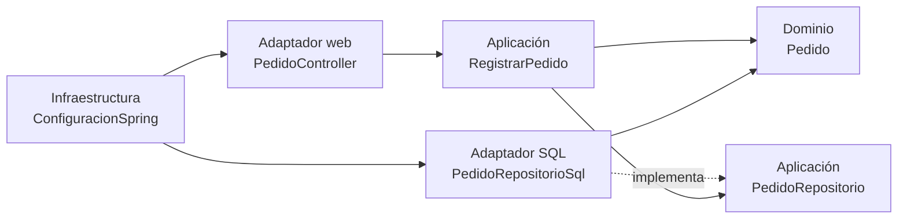

# Ejemplo de Arquitectura Limpia: registro de pedidos

Ejemplo funcional y deliberadamente sencillo basado en la diapositiva 9 de la presentación **Arquitectura Limpia**. Permite registrar pedidos desde una página web, calcular su total, guardarlos en SQLite y consultar los registros existentes.

La demostración busca evidenciar la regla principal de Arquitectura Limpia: **las capas internas no dependen de las tecnologías externas**. La entidad y los casos de uso no conocen Spring, HTTP, JDBC ni SQLite.

## Funcionalidad

- Registrar un pedido con cliente, producto, cantidad y precio unitario.
- Validar que los textos no estén vacíos, que la cantidad sea positiva y que el precio no sea negativo.
- Calcular el total dentro de la entidad de dominio.
- Persistir los pedidos en `pedidos.db`, creado automáticamente por SQLite.
- Listar los pedidos mediante una página web y una API REST.

## Requisitos

- Java 17 o superior.
- Maven 3.9 o superior.
- Internet únicamente durante la primera compilación para descargar dependencias.

No hace falta instalar SQLite, Spring ni un servidor de base de datos.

## Cómo ejecutar la demostración

Desde esta carpeta:

```bash
mvn spring-boot:run
```

Cuando aparezca el mensaje `Started AplicacionPedidos`, abrir:

```text
http://localhost:8080
```

Si el puerto 8080 ya está ocupado, iniciar la aplicación en otro puerto:

```bash
mvn "-Dspring-boot.run.arguments=--server.port=8081" spring-boot:run
```

En ese caso, abrir `http://localhost:8081`.

Desde la página se puede crear un pedido y verificar inmediatamente que aparece en la tabla. Para detener la aplicación, presionar `Ctrl+C`.

El archivo `pedidos.db` aparecerá en esta misma carpeta durante la primera ejecución. Los datos permanecen guardados aunque se cierre y vuelva a iniciar la aplicación.

## Prueba rápida de la API

Crear un pedido desde PowerShell:

```powershell
$pedido = @{
    cliente = "Ana"
    producto = "Cafe"
    cantidad = 2
    precioUnitario = 12000
} | ConvertTo-Json

Invoke-RestMethod -Method Post `
    -Uri http://localhost:8080/api/pedidos `
    -ContentType "application/json" `
    -Body $pedido
```

Listar los pedidos:

```powershell
Invoke-RestMethod http://localhost:8080/api/pedidos
```

También se puede utilizar `curl`:

```bash
curl -X POST http://localhost:8080/api/pedidos \
  -H "Content-Type: application/json" \
  -d '{"cliente":"Ana","producto":"Cafe","cantidad":2,"precioUnitario":12000}'

curl http://localhost:8080/api/pedidos
```

## Estructura y responsabilidad de las capas

```text
src/main/java/com/servired/pedidos/
├── dominio/
│   └── Pedido.java
├── aplicacion/
│   ├── DatosPedido.java
│   ├── PedidoRepositorio.java
│   ├── RegistrarPedido.java
│   └── ListarPedidos.java
├── adaptadores/
│   ├── web/PedidoController.java
│   └── sql/PedidoRepositorioSql.java
└── infraestructura/
    ├── AplicacionPedidos.java
    └── ConfiguracionSpring.java
```

### Dominio

`Pedido` contiene las reglas principales: valida los datos y calcula el total. Es Java puro y no tiene anotaciones de Spring.

### Aplicación

`RegistrarPedido` y `ListarPedidos` representan los casos de uso. Dependen de la interfaz `PedidoRepositorio`, no de SQLite.

### Adaptadores

`PedidoController` convierte solicitudes HTTP en llamadas a los casos de uso. `PedidoRepositorioSql` implementa la interfaz de la aplicación mediante JDBC y SQLite.

### Infraestructura

`ConfiguracionSpring` conecta las implementaciones externas con los casos de uso usando inyección de dependencias. `AplicacionPedidos` inicia Spring Boot.

## Regla de dependencias



La flecha importante apunta hacia adentro: el adaptador SQLite depende de la interfaz definida por la aplicación. La aplicación nunca importa el adaptador SQL.

## Relación con el taller de RabbitMQ

Se reutiliza la misma idea básica de persistencia del taller:

- SQLite crea un archivo local sin requerir un servidor adicional.
- La tabla se crea automáticamente mediante `CREATE TABLE IF NOT EXISTS`.
- Las consultas utilizan parámetros, evitando concatenar valores dentro del SQL.

La diferencia arquitectónica es que aquí el código SQL está encapsulado en un adaptador que implementa una interfaz de la capa de aplicación.

## Cómo demostrar Arquitectura Limpia en clase

1. Mostrar `Pedido.java` y señalar que no contiene imports de Spring o SQLite.
2. Mostrar `PedidoRepositorio.java`: el caso de uso define el contrato que necesita.
3. Mostrar `RegistrarPedido.java`: crea la entidad y llama al contrato sin saber cómo se guarda.
4. Mostrar `PedidoRepositorioSql.java`: es la implementación externa que conoce SQLite.
5. Registrar un pedido en `http://localhost:8080` y mostrar que aparece en la tabla.
6. Cerrar y volver a iniciar la aplicación para demostrar que el dato permanece en `pedidos.db`.

## Pruebas automatizadas

Ejecutar:

```bash
mvn test
```

Las pruebas comprueban el cálculo del dominio, el caso de uso sin Spring ni SQLite y el flujo completo por HTTP con una base SQLite de prueba.
